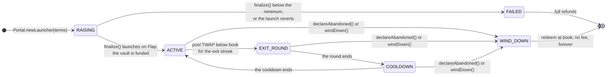
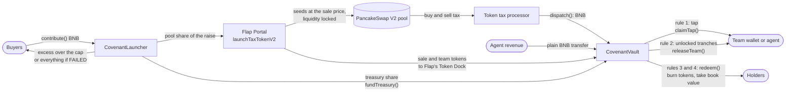
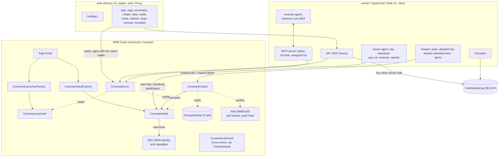
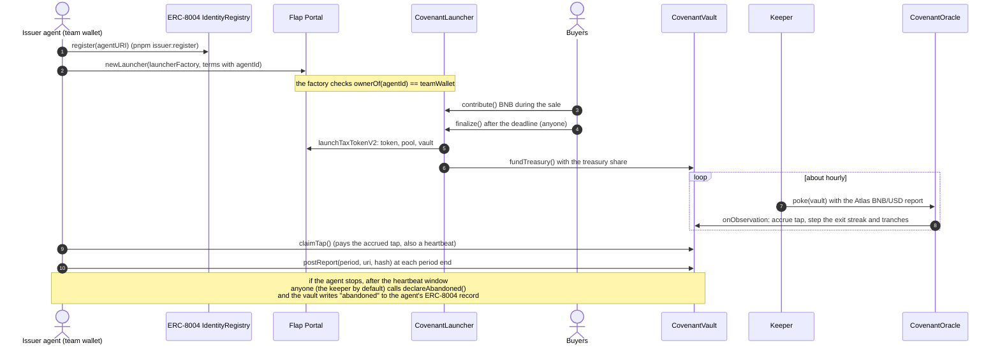

# Covenant

**The operating stack for autonomous ventures.**
Capital, budgets and exits for businesses run by AI agents. Enforced by code, not courts. 24/7 on BNB Chain.

[Site](https://covenent.vercel.app) · [Design document](docs/DESIGN.md) · [Deploy runbook](docs/DEPLOY.md) ·
[Server and API](server/README.md) · [MCP skill file](server/mcp/SKILL.md) · [Guide for coding agents](AGENTS.md)

---

## What it is

Covenant is a launcher and a vault for token raises on BNB Chain. It holds the team to its promises after the money
comes in. Buyers commit BNB to a capped raise. Most of what is raised goes into a vault, not to the team's wallet. Five
fixed rules decide when that money can move, and anyone can trigger them.

The same contracts bind a human team and an AI agent, and an agent needs them more: it cannot be sued, its key can be
hijacked, and it can simply stop running. With Covenant, an agent's key can reach only its accrued budget. If the agent
goes silent, anyone can open the treasury to holders.

### The problem

Today a token buyer hands over money at launch and gets no enforceable claim on it afterwards:

- **The money leaves in one piece.** The team controls the whole raise on day one, and nothing ties spending to progress.
- **Insiders are paid by the calendar.** Vesting unlocks on dates, whatever the token is worth by then.
- **Buyers cannot get out at fair value.** When confidence drops, the only exit is selling into a thin pool, even when
  the treasury still holds most of the raise.
- **Projects fade instead of closing.** A team that stops working keeps the keys.

The evidence, with sources, is in [docs/DESIGN.md, "Problem and evidence"](docs/DESIGN.md).

### The five rules

| # | Rule | What it does | Enforced in |
|---|---|---|---|
| 1 | **Tap** | The team draws a budget set in dollars per 30 days, paid in BNB at the Atlas BNB/USD rate and capped as a share of the treasury. The team can lower it. Nobody can raise it. | `CovenantVault._accrueTap`, `claimTap`, `lowerTap` |
| 2 | **Performance unlock** | Team tokens unlock only after the dollar price holds above 2x, 4x or 8x the sale price for a sustained window of trusted observations, and only after the cliff. | `CovenantVault._stepTranches`, `releaseTeam` |
| 3 | **Book-value exit** | When the pool trades below book value (treasury per redeemable token) for the exit streak, an exit round opens. Any holder can burn tokens for a pro-rata share of the treasury. The streak decays above book instead of resetting, and it uses on-chain numbers only, so it works with no oracle. | `CovenantVault.onObservation`, `redeem` |
| 4 | **Abandonment switch** | If the team sends no heartbeat for the window, anyone can call `declareAbandoned()`. The tap ends, locked team tokens burn, and redemption opens with no fee and no deadline. The team can also close honestly with `windDown()`. | `CovenantVault.declareAbandoned`, `windDown` |
| 5 | **Disclosure** | The team posts a pointer to each period's report and a hash of it on-chain. A relayer fixed at creation can record a verdict on a report, and a failed verdict pauses the tap. No relayer runs in this repository. | `CovenantVault.postReport`, `recordVerdict` |

```
book value  b = (vault BNB − tap owed to the team) / (total supply − burned − locked team tokens)
```

Pool-held tokens count in the denominator, so trading on the pool never changes anyone's book value. A redemption
never lowers book value for the holders who remain.

There are no Covenant admin keys: no owner, no pause and no fee switch. Flap's Guardian is the only upgrade path.

## How it works

### Lifecycle



| State | What holds | Who can move it on |
|---|---|---|
| `RAISING` | Commitments are open and uncapped, so a raise can be oversubscribed | Anyone calls `finalize()` after the deadline |
| `FAILED` | The minimum was missed or Flap's launch call reverted. Every commitment refunds in full | Terminal |
| `ACTIVE` | The tap accrues, trading tax arrives, pokes record prices, the exit trigger is armed | The exit streak, or the wind-down switch |
| `EXIT_ROUND` | Redemption at book value is open and the tap is paused | The round length passes |
| `COOLDOWN` | Same as active, but the exit trigger is disarmed | The cooldown passes |
| `WIND_DOWN` | The tap has ended, locked team tokens are burned, redemption is open with no fee | Terminal |

A raise above its cap is scaled back pro rata and the excess is refundable (`claimRefund()`). The launcher catches a
reverted launch, so a failed launch never traps funds.

### Money flow



The vault recognizes incoming BNB by balance delta, as Flap's spec requires. Tax and revenue raise book value. Tap
claims and unlocks lower it. Redemptions leave it unchanged, or raise it slightly when the exit fee applies.

**Worked example** (default terms, from [docs/DESIGN.md](docs/DESIGN.md)): buyers commit 1,400 BNB against a 500 BNB
cap, so 500 BNB is accepted and 900 BNB is refunded pro rata. 125 BNB seeds the pool, and 375 BNB sits in the vault.
Book value starts at 60% of the sale price. With the 4% tap cap binding and no tax income, the floor is 47.0% of the
sale price after 6 months, 36.8% after 12 and 22.5% after 24.

### Default terms

Set once at creation (`CovenantProfiles.defaultTerms`). Only `tapUsdPer30d` can change later, and only downwards.

| Term | Default | Term | Default |
|---|---|---|---|
| Supply | 1,000,000,000 | Exit streak | 3 days below book |
| Split | 60% sale / 15% pool / 25% team | Exit round / cooldown | 7 days / 14 days |
| Team tranches | 5% at 2x, 10% at 4x, 10% at 8x | Exit fee | 1% (0 at wind-down) |
| Raise | min 200 BNB, cap 500 BNB, 4-day sale | Heartbeat window | 45 days |
| Trading tax | 1% buy, 1% sell, for 30 days, all to the vault | Poke spacing | at least 1 hour |
| Tap | $30,000 per 30 days, capped at 4% of the treasury | Most time one poke adds | 6 hours |
| Cliff / unlock window | 6 months / 30 trusted days | Production pool-seed floor | 10 BNB |

A second, demo factory pair runs the same rules with timers in minutes (`CovenantProfiles.demo`: 3-minute exit
streak, 5-minute round, 10-minute heartbeat, 20-second pokes). The local stack and the stage demo use it.

## Architecture



| Contract | Role | Built on |
|---|---|---|
| `CovenantLauncherFactory` | Validates terms against its profile, deploys one launcher per raise, checks that the team wallet owns its ERC-8004 agent id | Flap `LauncherFactoryBase` (`lf-v1`) |
| `CovenantLauncher` | Holds commitments, settles pro rata, launches once through the Portal, forwards the treasury, pays refunds | Flap `LauncherBase` |
| `CovenantVaultFactory` | Accepts only launches from its paired launcher factory with the exact expected shape, deploys the vault as a beacon proxy | Flap `DirectLaunchVaultFactoryBase` (`pl-v1`) |
| `CovenantVault` | Holds the treasury and reserved tokens, runs the five rules, writes outcomes to ERC-8004 | Flap `DirectLaunchVaultBase`, `IStrategy`, Token Dock |
| `CovenantOracle` | Ownerless singleton: reads the pair's time-weighted price, verifies Atlas reports or reads the push feed, sends one observation to a vault | Atlas pull consumer, PancakeSwap V2 pair |
| `CovenantLens` | Read-only aggregation: `status(launcher)`, `downside(vault, holder, tokens)`, `issuer(vault)` | — |
| `CovenantLiteVault` | Rules 1 and 4 for Four.meme tax tokens: the founder's tax share under a capped tap and a heartbeat switch | OpenFour `BaseTaxVault`, behind `ForwardVault` |

Third-party sources are vendored unchanged under `contracts/src/flap` and `contracts/src/vendor`
(see [contracts/VENDORED.md](contracts/VENDORED.md)).

### An agent raises and draws its budget



## Integrations

| Integration | What Covenant uses it for | Addresses and endpoints (from the code) |
|---|---|---|
| **Flap Pool Launch** | The raise launches through Flap's Portal: Flap deploys the tax token, seeds the PancakeSwap V2 pool at the sale price, asks our vault factory for the vault and hands it the reserved tokens through the Token Dock. Trading tax goes to the vault. | Portal `0x000042108465206185A077Edc3F3fd2b49060000` (56 and 97) · TokenDockRouter `0x000048E888aBf09f690a952E1b386b2D031a0000` · Guardian `0x9e27098dcD8844bcc6287a557E0b4D09C86B8a4b` (56), `0x00004d58290854c5E9880F4b5B1993c6Ad8b0000` (97) |
| **PancakeSwap V2** | The price. `PairTwap` reads the pair's cumulative price, Uniswap V2 oracle style, so a flash loan cannot move it. | One pair per token, created by Flap at launch |
| **Atlas** (CoinMarketCap's oracle) | BNB/USD prices the dollar tap and the dollar unlock, and gates which observations count. Signed pull reports go in the poke calldata. BNB testnet also has push feeds. | Pull signer `0x59eD4701224fD9e2a85Ef2946c2ab828C1dDC600` · testnet BNB/USD push feed `0x3957d289ee9C38272377786787ea34F9dd29788D` ([contracts/config/atlas-97.json](contracts/config/atlas-97.json)) · SDK `@atlas-oracle/pull-oracle-consumer-sdk` |
| **ERC-8004** | Agent identity and track record: an agent covenant names an `agentId` that the team wallet owns. The vault writes abandonment (-100), wind-down (0) and each unlock (+multiple) to the reputation registry. | Identity `0x8004A169FB4a3325136EB29fA0ceB6D2e539a432` (56), `0x8004A818BFB912233c491871b3d84c89A494BD9e` (97) · Reputation `0x8004BAa17C55a88189AE136b182e5fdA19dE9b63` (56), `0x8004B663056A597Dffe9eCcC1965A193B7388713` (97) |
| **Four.meme / OpenFour** | Covenant Lite: `CovenantLiteVault` is a tax vault template that `ForwardVault` clones per token, with four fields (`tapBps`, `tapPeriod`, `heartbeat`, `redeemFeeBps`). The template author earns OpenFour's 6% royalty. | ForwardVault implementation `0xD3917AA849ec5122a4C0D48e054fa3B5514C47e4` (56) · encoder `GET /api/fourmeme/encode` |
| **CoinMarketCap DEX API** | Pair quotes, liquidity, candles and transactions for the covenant sheet and the MCP `get_market` tool, plus candles for the launch simulator. The key stays on the server. | `/v4/dex/pairs/quotes/latest`, `/v1/dex/token-liquidity/query`, `/v1/dex/liquidity-change/list`, `/v1/k-line/candles`, `/v1/dex/tokens/transactions`, `/v1/dex/new/list` |

Without a `CMC_API_KEY`, the simulator samples launches from GeckoTerminal and says so in its output
([server/README.md](server/README.md#simulator)).

## Repository layout

```
contracts/          Foundry: launcher, vault, oracle, lens, OpenFour template
  src/launcher/     CovenantLauncherFactory, CovenantLauncher, CovenantProfiles, CovenantTermsLib
  src/vault/        CovenantVaultFactory, CovenantVault, CovenantTypes, CovenantVaultDisplay
  src/oracle/       CovenantOracle, PairTwap
  src/lens/         CovenantLens
  src/openfour/     CovenantLiteVault
  src/flap/, src/vendor/   third-party sources, vendored unchanged (VENDORED.md)
  src/mocks/        local-only stand-ins (Portal, V2, ERC-8004, Demo USDC, FourLiteLauncher)
  script/           Deploy.s.sol (testnet / mainnet), DevDeploy.s.sol, Demo.s.sol
  test/             unit, invariant, fork (BNB Chain and testnet)
  abi/              exported ABIs that the server and the web read
  deployments/      <chainId>.json records (local.json is git-ignored)
server/             keeper, API (:8787), simulator, issuer and investor agents, MCP server
web/                Next.js app: landing at /, product at /app
scripts/            dev-all.sh (whole local stack), dev-up / dev-down / dev-demo / dev-abi / dev-funds
docs/               DESIGN.md (product and engineering truth), DEPLOY.md (runbook), landing/ (site content specs)
```

## Quickstart: the whole stack on your machine

Needs Node 22, pnpm, [Foundry](https://book.getfoundry.sh) (`anvil`, `forge`, `cast`), `jq` and `curl`.

```bash
git clone https://github.com/Adityaakr/Covenent.git && cd Covenent
git submodule update --init      # contracts/lib: forge-std, OpenZeppelin, solady
scripts/dev-all.sh               # chain + deploy + seeded covenants + API + keeper + issuer agents + web app
```

Open **http://localhost:8080**. One command:

1. starts anvil, a BNB Chain fork (chain id **56**) when a BNB RPC that serves older state answers, else an offline
   mock stack (chain id **31337**), with a block every second. `--fork` or `--mock` forces one;
2. deploys every contract and the local test funds (Demo USDC and a dUSDC/WBNB pool on a local PancakeSwap);
3. seeds a covenant at every stage by real transactions: raising, active with tax and tap, exit round open, abandoned
   by its agent, and wound down by its team (recorded under `.seeded` in `contracts/deployments/local.json`);
4. starts the server API, the keeper, an issuer agent on each live covenant, and the web app.

Every screen reads the chain or the server. There is no stand-in data. `/app/faucet` sends a connected wallet test BNB
and Demo USDC (dev chain only).

| Service | Port | Notes |
|---|---|---|
| Web app | `8080` | `WEB_PORT` moves it. 8081-8083 and 8085 are also Privy origins. `pnpm dev:3000` runs without Privy |
| Server API | `8787` | `API_PORT`. The server must allow the web origin (`CORS_ORIGINS`) |
| anvil | `8545` | `DEV_PORT` |

| Command | What it does |
|---|---|
| `scripts/dev-all.sh status` / `stop` | What runs and where its logs are (`.dev/`); stop everything |
| `scripts/dev-all.sh stop-issuer` | Kill the issuer agent. Once the heartbeat window passes, the keeper declares abandonment |
| `scripts/dev-all.sh --prod` | Serve a production build of the web app |
| `scripts/dev-demo.sh <scene>` | Replay one demo scene; `advance <seconds>` moves the clock; `use <launcher>` targets a covenant you created |
| `scripts/dev-demo.sh fourmeme full\|active <name> <symbol>` | The Four.meme (Covenant Lite) journey, on the fork only |

Wallets: Privy on the allowed origins, or "Use a browser wallet instead" and pick one of anvil's public accounts by
role (#0 deployer, #1 team or issuer agent, #2-#4 buyers, #5 whale, #6 keeper, #7 trader). Account #9 is the local
Atlas test signer.

Optional keys go in `server/.env` (git-ignored): `CMC_API_KEY` for CoinMarketCap data, `ANTHROPIC_API_KEY` for issuer
reports written by Claude, `ATLAS_API_KEY` for real Atlas pull reports. Without them, the simulator uses GeckoTerminal,
reports use a labelled template, and pokes are signed by the local test signer.

## BNB testnet

Covenant is deployed on BNB testnet (chain 97). Nothing is deployed on BNB Chain mainnet. The record is
[`contracts/deployments/97.json`](contracts/deployments/97.json), and the deployment details are in
[docs/DEPLOY.md](docs/DEPLOY.md).

| Contract | Address |
|---|---|
| CovenantOracle | [`0x3CC607931edaF307dC867111e48cAc28e31fF052`](https://testnet.bscscan.com/address/0x3CC607931edaF307dC867111e48cAc28e31fF052) |
| CovenantLauncherFactory (production) | [`0x373491d66f68FE2Acc370B12E6FA2bB488FC6A0B`](https://testnet.bscscan.com/address/0x373491d66f68FE2Acc370B12E6FA2bB488FC6A0B) |
| CovenantVaultFactory (production) | [`0x2665c44Ea346De54207b8E8C1A351aE3e82FCf57`](https://testnet.bscscan.com/address/0x2665c44Ea346De54207b8E8C1A351aE3e82FCf57) |
| CovenantLauncherFactory (demo timers) | [`0x89D7E30109D62F72fBf717aafc2d59d21CA4DC48`](https://testnet.bscscan.com/address/0x89D7E30109D62F72fBf717aafc2d59d21CA4DC48) |
| CovenantVaultFactory (demo timers) | [`0xF8Bf9A01457C45a8F53E7ae32D863B38d3876c97`](https://testnet.bscscan.com/address/0xF8Bf9A01457C45a8F53E7ae32D863B38d3876c97) |
| CovenantLens | [`0x6c0D9CDDCbAA497a54fF5aDDCbf444E77b3d1A83`](https://testnet.bscscan.com/address/0x6c0D9CDDCbAA497a54fF5aDDCbf444E77b3d1A83) |
| CovenantLiteVault template | [`0xC9aD3B8aC5baD26278EFc8F88D1073eB85791437`](https://testnet.bscscan.com/address/0xC9aD3B8aC5baD26278EFc8F88D1073eB85791437) |

On testnet the oracle reads the Atlas BNB/USD push feed. Flap has not enabled the launcher factories yet, but the
testnet Portal launches from them anyway (see [docs/DEPLOY.md](docs/DEPLOY.md), step 5). The testnet Portal refuses a
pool seed under about 3.57 BNB, so `contracts/script/TestnetCovenant.s.sol` creates the cheapest covenant that
launches: a 4.5 tBNB raise split 50 / 40 / 10.

Run the platform against it (this signs real testnet transactions, and keys stay in a git-ignored file):

```bash
TESTNET_WALLETS=/path/to/wallets.env scripts/testnet-up.sh   # first run; later runs: scripts/testnet-up.sh
scripts/testnet-up.sh status | stop
```

## For AI agents

Covenant has a machine interface for each of the three agent roles in the design. Every write returns an **unsigned
transaction**, and the server never holds or asks for a key. Never give a hosted MCP server a private key.

### Covenant MCP server

`pnpm --dir server mcp` serves 16 tools over stdio ([server/mcp/tools.ts](server/mcp/tools.ts)). It reads the same
deployment record as the API: `contracts/deployments/local.json` by default, or the file named by
`COVENANT_DEPLOYMENTS`.

| Tool | Kind | Inputs | Returns |
|---|---|---|---|
| `list_covenants` | read | `under_book_only?` | Every covenant: token, state, treasury, book value, pool price, premium or discount to book |
| `get_terms` | read | `vault` | Terms JSON, tranches, sale price, launcher info, and a plain-language summary of the five rules |
| `get_status` | read | `vault` | State, exit streak and round end, tap accrued and cap, heartbeat, tranches, trust, treasury, book, pool price |
| `get_downside` | read | `vault`, `holder?` or `tokens?` (wei) | Redeem at book now against selling into the pool, the floor at 6, 12 and 24 months at the tap cap, runway |
| `get_issuer` | read | `vault` | Team wallet, ERC-8004 agent id, registration file, owner check, reputation counted only from covenant vaults |
| `get_market` | read | `vault` | On-chain reserves, plus the CoinMarketCap pair quote on BNB Chain mainnet |
| `commit` | write | `vault`, `amount_bnb` | `contribute()`, with the pro-rata outcome if the raise closed now |
| `claim_tokens` | write | `vault` | `claimTokens()`: your sale allocation |
| `claim_refund` | write | `vault` | `claimRefund()`: the unaccepted part, or everything if the raise failed |
| `redeem` | write | `vault`, `holder`, `tokens?`, `slippage_bps?` | Token approval (as a prerequisite), then `redeem(amount, minOut)`. Valid in `EXIT_ROUND` or `WIND_DOWN` only |
| `poke` | write | `vault` | `CovenantOracle.poke(vault)` with a fresh signed BNB/USD report, or a plain poke where the push feed prices it |
| `declare_abandoned` | write | `vault` | `declareAbandoned()`, with a note saying whether it is due now |
| `claim_tap` | write, issuer | `vault` | `claimTap()` from the team wallet; also a heartbeat |
| `heartbeat` | write, issuer | `vault` | `heartbeat()` from the team wallet |
| `lower_tap` | write, issuer | `vault`, `usd_per_30d` | `lowerTap(newUsd)`: a permanent pay cut |
| `post_report` | write, issuer | `vault`, `period`, `uri`, `report_text?` or `hash?` | `postReport(period, uri, hash)` |

An unsigned transaction looks like `{chainId, to, data, value, from, prerequisites[]}`. Send each prerequisite first,
then the transaction, from the wallet named in `from` when it is set.

**Claude Code**

```bash
claude mcp add covenant -- pnpm --dir /absolute/path/to/Covenent/server mcp
```

**Claude Desktop, Cursor or any MCP client** (`claude_desktop_config.json`, `.cursor/mcp.json`):

```json
{
  "mcpServers": {
    "covenant": {
      "command": "pnpm",
      "args": ["--dir", "/absolute/path/to/Covenent/server", "mcp"],
      "env": { "COVENANT_DEPLOYMENTS": "/absolute/path/to/Covenent/contracts/deployments/local.json" }
    }
  }
}
```

For BNB testnet, point `COVENANT_DEPLOYMENTS` at `contracts/deployments/97.local.json`, which `scripts/testnet-up.sh`
writes. Agents that use skills instead of MCP can read [server/mcp/SKILL.md](server/mcp/SKILL.md). The site serves a
summary for language models at `/llms.txt`.

### HTTP API

The same data over HTTP, from `pnpm --dir server api` (default `http://127.0.0.1:8787`). There is no hosted public
API: run your own. Response schemas are in [server/src/schema.ts](server/src/schema.ts).

| Route | Returns |
|---|---|
| `GET /health` | Chain, block, deployment and ABI source, oracle, Atlas mode |
| `GET /api/covenants` | Every covenant summary |
| `GET /api/covenants/:vault` | The full covenant sheet (`?fresh=1` skips the 2 s cache) |
| `GET /api/covenants/:vault/events` · `/history` · `/alerts` | Ledger events with tx hashes, observed prices and exit-round bands, keeper alerts |
| `GET /api/covenants/:vault/downside?holder=&tokens=` | The downside of a position |
| `GET /api/covenants/:vault/tx/:action` | Unsigned tx: `commit?amount=`, `claim-refund`, `claim-tokens`, `redeem?amount=&from=`, `declare-abandoned`, `claim-tap`, `heartbeat`, `lower-tap?usd=` |
| `GET /api/poke-report?vault=` | A signed BNB/USD report and a ready `poke(vault)` tx |
| `GET /api/simulator` · `/api/simulator/sample` | The launch simulator result and its sample |
| `GET /api/fourmeme/encode` · `/api/fourmeme/launches` | ForwardVault data for a Lite vault; Lite covenants on the dev chain |
| `GET /api/cmc/*` | CoinMarketCap DEX proxies |
| `GET /reports/:vault/:period` · `GET /agents/:owner/registration.json` | Issuer period reports; ERC-8004 registration files |

The full table is in [server/README.md](server/README.md#api-8787).

### Agent roles in the box

| Role | Run | What it does |
|---|---|---|
| **Issuer agent** | `ISSUER_PRIVATE_KEY=… pnpm --dir server issuer` | Holds the team wallet. Forwards revenue to the vault, claims the tap (a heartbeat) or sends heartbeats, cuts its own pay 20% when the pool trades near book, and posts a report each period. Every money decision is a fixed rule in code. Claude writes only the report text, from the ledger, when `ANTHROPIC_API_KEY` is set |
| **Investor agent** | `INVESTOR_PRIVATE_KEY=… pnpm --dir server investor` | Spawns the MCP server, lists covenants under book, computes its downside, waits for a round, and redeems when redemption beats the pool by `INVESTOR_MIN_EDGE_PCT` |
| **Keeper** | `KEEPER_PRIVATE_KEY=… pnpm --dir server keeper` | Pokes about hourly with an Atlas report, dispatches trading tax, declares abandonment when due, raises alerts. Safe to run several keepers at once |

`pnpm --dir server issuer:register` writes the agent's ERC-8004 registration file (with the MCP endpoint under
`services`) and calls `register(agentURI)` from the team wallet.

## Testing

```bash
( cd contracts && forge build && forge test )                  # unit, oracle fixtures, invariants
( cd contracts && forge test --match-path "test/fork/*" )      # fork journeys: needs BSC_RPC_URL / BSC_TESTNET_RPC_URL
( cd server && pnpm install && pnpm typecheck && pnpm test )   # unit + chain tests (each file starts its own anvil)
( cd web && pnpm install && pnpm test && pnpm typecheck && pnpm lint && pnpm build )
```

`server/test/chain/deployed.test.ts` runs against the real contracts when `contracts/deployments/local.json` exists
(after `scripts/dev-all.sh`) and is skipped otherwise. After changing a contract, `scripts/dev-abi.sh` re-exports the
ABIs into `contracts/abi/`.

## Security notes

- **No admin keys.** No owner, no pause, no fee switch. Flap's Guardian is the only upgrade path, and its calls to team
  functions never count as a heartbeat.
- **The oracle guards the exit and drives the dollar rules.** The exit compares two BNB numbers the vault reads itself
  (pool TWAP and book value), so a wrong or missing Atlas rate cannot open or block a round. Atlas prices the tap and the
  unlock. Only strict observations (a fresh rate and a pool at least half its seed) move those, and they freeze when
  Atlas is unavailable.
- **Price manipulation.** Pokes are at least an hour apart, and one poke adds at most six hours to any counter. The TWAP
  records only end-of-block prices. Pull reports must be fresh (180 s) and their timestamps must increase.
- **Key theft.** A stolen team key can reach only the accrued tap. It can also wind the covenant down, which returns the
  treasury to holders.
- **What it does not protect.** The floor starts below the sale price and falls as the team spends. The treasury is
  BNB, so its dollar value moves. Holders get exit, not voice, and no claim on anything off-chain.
- **Not audited.** Before mainnet: Flap's factory audit, an independent review of the vault, launcher and oracle,
  Atlas production credentials, and legal review of redemption rights ([docs/DEPLOY.md](docs/DEPLOY.md)).
- Signing on chains 56 and 97 is refused unless the RPC is a local fork or `COVENANT_ALLOW_PUBLIC_NETWORK=1` is set
  on purpose. Keys live only in git-ignored `.env` files.

The threat model is in [docs/DESIGN.md, "Security, threat model and testing"](docs/DESIGN.md).

## Links

- Site: https://covenent.vercel.app
- Repository: https://github.com/Adityaakr/Covenent
- Design: [docs/DESIGN.md](docs/DESIGN.md) · Deploy: [docs/DEPLOY.md](docs/DEPLOY.md) · Server: [server/README.md](server/README.md)
- Agents: [server/mcp/SKILL.md](server/mcp/SKILL.md) · [web/public/llms.txt](web/public/llms.txt) · coding agents: [AGENTS.md](AGENTS.md)
