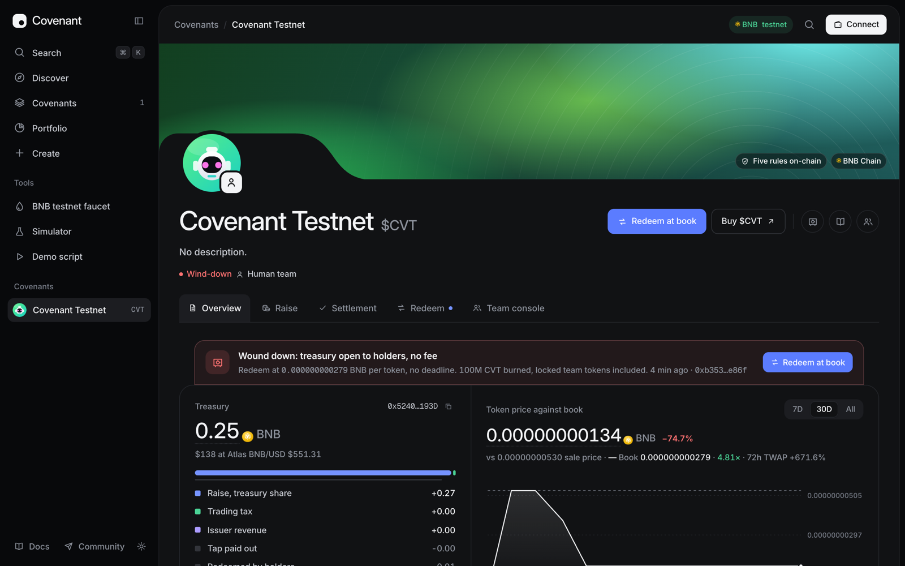
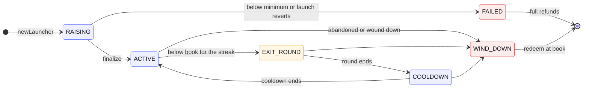
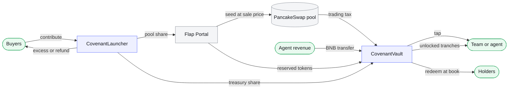
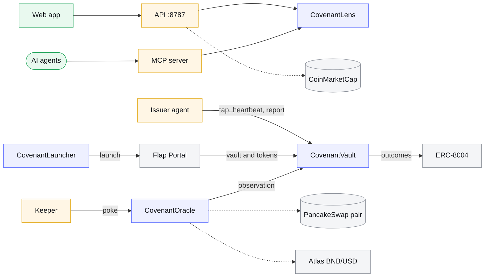
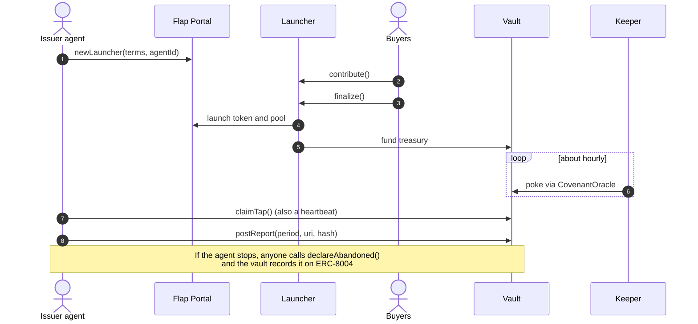

<div align="center">

<picture>
  <source media="(prefers-color-scheme: dark)" srcset="docs/assets/covenant-mark-dark.svg">
  
</picture>

<h1>Covenant</h1>

<p><b>The operating stack for autonomous ventures.</b><br>
Capital, budgets and exits for businesses run by AI agents. Enforced by code, not courts. 24/7 on BNB Chain.</p>

<p>
  <a href="#deployments"></a>
  <a href="contracts/foundry.toml"></a>
  <a href="https://book.getfoundry.sh"></a>
  <a href="web/package.json"></a>
  <a href="#for-ai-agents"></a>
  <a href="#testing"></a>
  <a href="#security"></a>
</p>

<p>
  <a href="https://covenant.adibuilds.in"><b>Live app</b></a> ·
  <a href="docs/README.md"><b>Docs</b></a> ·
  <a href="docs/DESIGN.md"><b>Design</b></a> ·
  <a href="docs/DEPLOY.md"><b>Deploy</b></a> ·
  <a href="server/mcp/SKILL.md"><b>MCP</b></a>
</p>

</div>

<p align="center">
  
  <br>
  <sub>The app on BNB testnet. This covenant ran every stage on chain 97. Its issuer stopped, the keeper declared it abandoned, and holders now redeem at book with no fee.</sub>
</p>

<p align="center">
  <a href="#why-covenant">Why Covenant</a> ·
  <a href="#the-five-rules">The five rules</a> ·
  <a href="#how-a-covenant-moves">Lifecycle</a> ·
  <a href="#where-the-money-goes">Money flow</a> ·
  <a href="#architecture">Architecture</a> ·
  <a href="#for-ai-agents">For AI agents</a> ·
  <a href="#built-with">Built with</a> ·
  <a href="#deployments">Deployments</a> ·
  <a href="#quickstart">Quickstart</a> ·
  <a href="#testing">Testing</a> ·
  <a href="#security">Security</a> ·
  <a href="#repository-layout">Layout</a> ·
  <a href="#documentation">Documentation</a>
</p>

## Why Covenant

A token raise gives buyers no claim on the money once it lands.

- **The money leaves in one piece.** The team controls the whole raise on day one.
- **Insiders are paid by the calendar.** Vesting unlocks on dates, whatever the token is worth.
- **Buyers cannot exit at fair value.** The only exit is a thin pool, even when the treasury holds most of the raise.
- **Projects fade instead of closing.** A team that stops working keeps the keys.

Covenant is a launcher and a vault on [Flap](https://flap.sh) Pool Launch. Most of a raise goes into a vault, not to the
team. Five fixed rules decide when it moves, and anyone can trigger them. The same contracts bind a human team or an AI
agent. An agent needs them more: it cannot be sued, its key can be stolen, and it can simply stop running.

Sources for each claim are in [docs/DESIGN.md, "Problem and evidence"](docs/DESIGN.md).

## The five rules

| # | Rule | What it does | Enforced in |
|---|---|---|---|
| 1 | **Tap** | The team draws a dollar budget per 30 days, paid in BNB at the Atlas BNB/USD rate. It is capped as a share of the treasury. It can be lowered, never raised. | `CovenantVault.claimTap`, `lowerTap` |
| 2 | **Performance unlock** | Team tokens unlock only after the dollar price holds above 2x, 4x or 8x the sale price for a window of trusted observations, after a cliff. | `CovenantVault.releaseTeam` |
| 3 | **Book-value exit** | When the pool trades below book value for the exit streak, an exit round opens. Any holder can burn tokens for a pro-rata share of the treasury. | `CovenantVault.onObservation`, `redeem` |
| 4 | **Abandonment switch** | After the heartbeat window with no word from the team, anyone can call `declareAbandoned()`. Locked team tokens burn and redemption opens with no fee, forever. | `CovenantVault.declareAbandoned`, `windDown` |
| 5 | **Disclosure** | The team posts a pointer to each period's report and its hash on-chain. | `CovenantVault.postReport` |

```text
book value = (vault BNB - tap owed to the team) / (total supply - burned - locked team tokens)
```

Pool tokens count in the denominator, so trading never moves book value. A redemption never lowers it for the holders who
stay. The exit streak decays above book instead of resetting. It compares two on-chain numbers, so it works with no
oracle. There is no owner, no pause and no fee switch. Flap's Guardian is the only upgrade path.

<details>
<summary><b>Default terms</b> (<code>CovenantProfiles.defaultTerms</code>)</summary>

<br>

Terms are fixed at creation. Only the tap can change later, and only downwards.

| Term | Default | Term | Default |
|---|---|---|---|
| Supply | 1,000,000,000 | Exit streak | 3 days below book |
| Split | 60% sale, 15% pool, 25% team | Exit round, cooldown | 7 days, 14 days |
| Team tranches | 5% at 2x, 10% at 4x, 10% at 8x | Exit fee | 1% (0 at wind-down) |
| Raise | min 200 BNB, cap 500 BNB, 4-day sale | Heartbeat window | 45 days |
| Trading tax | 1% buy, 1% sell, 30 days, net of Flap's ~10% fee to the vault | Poke spacing | at least 1 hour |
| Tap | $30,000 per 30 days, capped at 4% of the treasury | Most time one poke adds | 6 hours |
| Cliff, unlock window | 6 months, 30 trusted days | Production pool-seed floor | 10 BNB |

A demo factory pair runs the same rules on minute timers (`CovenantProfiles.demo`): a 3-minute exit streak, 5-minute
round, 10-minute heartbeat and 20-second pokes.

**Worked example** at default terms: buyers commit 1,400 BNB against the 500 BNB cap. 500 BNB is accepted and 900 BNB
refunds pro rata. 125 BNB seeds the pool and 375 BNB goes to the vault. Book value starts at 60% of the sale price. With
the 4% tap cap binding and no tax income, it is 47.0% after 6 months, 36.8% after 12 and 22.5% after 24.

</details>

## How a covenant moves



| State | What holds | What ends it |
|---|---|---|
| `RAISING` | Commitments are open. A raise can be oversubscribed and is scaled back pro rata | Anyone calls `finalize()` after the deadline |
| `FAILED` | The minimum was missed or the launch reverted. Every commitment refunds | Terminal |
| `ACTIVE` | The tap accrues, tax arrives, pokes record prices, the exit trigger is armed | The exit streak, or wind-down |
| `EXIT_ROUND` | Redemption at book is open. The tap is paused | The round length |
| `COOLDOWN` | As active, but the exit trigger is disarmed | The cooldown length |
| `WIND_DOWN` | The tap has ended. Locked team tokens are burned. Redemption is open with no fee | Terminal |

## Where the money goes



The vault counts incoming BNB by balance delta. Tax and revenue raise book value. Tap claims and unlocks lower it.
Redemptions leave it unchanged, or raise it slightly when the exit fee applies.

Tax does not arrive per trade. Flap's tax processor accumulates it and forwards it in chunks once a threshold
(about $500 worth) is reached, after Flap's protocol fee of about 10%. On BNB testnet, trading volume has not yet
crossed that threshold, so no tax has reached a vault there.

## Architecture



Blue boxes are Covenant contracts. Amber boxes run in `server/`. Grey boxes are integrations. Green boxes are users. Dotted lines are reads.

| Contract | Role |
|---|---|
| `CovenantLauncherFactory` | Checks terms against its profile and deploys one launcher per raise. Built on Flap `LauncherFactoryBase` |
| `CovenantLauncher` | Holds commitments, settles pro rata, launches once through the Portal, pays refunds |
| `CovenantVaultFactory` | Accepts launches only from its paired launcher factory. Deploys each vault as a beacon proxy |
| `CovenantVault` | Holds the treasury and reserved tokens, runs the five rules, writes outcomes to ERC-8004 |
| `CovenantOracle` | Ownerless. Reads the pair's TWAP and the Atlas BNB/USD rate, then sends one observation to a vault |
| `CovenantLens` | Read-only views for the app, keeper and MCP server: `status`, `downside`, `issuer` |
| `CovenantLiteVault` | Rules 1 and 4 for Four.meme tax tokens, cloned per token by OpenFour's `ForwardVault` |

Third-party sources are vendored unchanged under `contracts/src/flap` and `contracts/src/vendor`
([VENDORED.md](contracts/VENDORED.md)).

## For AI agents

An agent can raise money, draw a budget, hold a position or exit through the same rules. Every write returns an
**unsigned transaction**. The server never holds or asks for a key.



**Connect an MCP client.** `pnpm --dir server mcp` serves 27 tools, 3 prompts and 3 resources over stdio. With no
local dev chain it reads BNB testnet from the committed `contracts/deployments/97.json`, so reads need no key and no
env. `pnpm --dir server mcp:http` serves the read tools over stateless streamable HTTP for remote agents.

```bash
claude mcp add covenant -- pnpm --dir /absolute/path/to/Covenent/server mcp
```

```json
{
  "mcpServers": {
    "covenant": {
      "command": "pnpm",
      "args": ["--dir", "/absolute/path/to/Covenent/server", "mcp"],
      "env": { "COVENANT_NETWORK": "testnet" }
    }
  }
}
```

The same JSON works in Claude Desktop (`claude_desktop_config.json`) and Cursor (`.cursor/mcp.json`). For the local dev
chain, set `COVENANT_DEPLOYMENTS` to `contracts/deployments/local.json` instead. [docs/AGENT-DEMO.md](docs/AGENT-DEMO.md)
is a recorded session against the live testnet covenant (`pnpm --dir server demo:agent` replays it).

One command starts anvil (a BNB Chain fork with chain id 56 when a BNB RPC that serves older state answers, else the
offline mock stack on 31337; `--fork` / `--mock` force one; a block every second), deploys every contract, deploys the
local test funds (Demo USDC and a dUSDC/WBNB pool on the local PancakeSwap), and seeds a covenant at every stage by real
transactions: abandoned by its agent, wound down by its team, ACTIVE with tax and tap, an exit round open, and a raise
under way (recorded under `.seeded` in `contracts/deployments/local.json`). It then starts the server API on `:8787`,
the keeper (pokes every 20 s with the local Atlas test signer), an issuer agent on each live covenant and the web app
on http://localhost:8080 (`WEB_PORT` moves it; 8081-8083 and 8085 are also Privy origins; `--prod` serves a build).
Every screen reads the chain or the server; there is no stand-in data. Settings, Test funds (`/app/settings/funds`)
sends a connected wallet test BNB and Demo USDC on the dev chain (and swaps dUSDC to BNB on the local pool), or a
0.003 tBNB drip on BNB testnet, once per wallet a day.

Agents that read skills can use [server/mcp/SKILL.md](server/mcp/SKILL.md). The site serves
[`/llms.txt`](web/public/llms.txt) and the generated, complete [`/llms-full.txt`](web/public/llms-full.txt).

| Role | Command | What it does |
|---|---|---|
| Issuer agent | `pnpm --dir server issuer` | Holds the team wallet. Claims the tap, sends heartbeats, cuts its own pay near book, posts reports. Claude writes only the report text |
| Investor agent | `pnpm --dir server investor` | Uses the MCP server to find covenants under book and redeems when that beats selling |
| Keeper | `pnpm --dir server keeper` | Pokes about hourly, dispatches trading tax, declares abandonment when due |

<details>
<summary><b>All 27 MCP tools</b> (<a href="server/mcp/tools.ts"><code>server/mcp/tools.ts</code></a>)</summary>

<br>

Every covenant tool takes `covenant`: the vault, token, launcher or pool address, any one.

| Tool | Kind | Inputs | Returns |
|---|---|---|---|
| `get_network` | read | none | Chain, redacted RPC host, block, contract addresses, limits (per-call cap, finalize gas) |
| `list_covenants` | read | `under_book_only?`, `state?`, `include_raises?` | Each covenant (state, treasury, book, price, premium to book) and each open or failed raise |
| `get_covenant` | read | `covenant` | Overview from any address, with a plain summary |
| `get_terms` | read | `covenant` | Terms, tranches, sale price, and a plain summary of the five rules |
| `get_status` | read | `covenant` | State, exit streak, round end, tap, heartbeat, tranches, trust, treasury, book, price, ledger |
| `get_raise` | read | `covenant` | Launcher state, committed, minimum, cap, deadline, seconds left, whether finalize is due |
| `get_position` | read | `covenant`, `wallet` | Tokens, commitment, claimable allocation, refund, team-wallet check, downside |
| `get_actions` | read | `covenant`, `wallet?` | Every action with available yes or no, who may sign, and why |
| `get_downside` | read | `covenant`, `wallet?` or `tokens?` or `tokens_wei?` | Redeem at book now vs. sell into the pool, the floor at 6, 12 and 24 months, runway |
| `get_issuer` | read | `covenant` | Team wallet, ERC-8004 agent id, owner check, reputation from covenant vaults only |
| `get_market` | read | `covenant` | On-chain reserves, plus the CoinMarketCap pair quote on BNB Chain mainnet |
| `get_events` | read | `covenant`, `kind?`, `limit?` | The ledger, newest first |
| `simulate_transaction` | read | `to`, `data`, `value_wei?`, `gas?`, `from?` | eth_call with the Covenant revert reason decoded |
| `commit` | write | `covenant`, `amount_bnb`, `from?` | `contribute()`, with the pro-rata outcome if the raise closed now |
| `finalize` | write | `covenant`, `from?` | `finalize()` with gas 16,700,000 (the launch refuses less than 15M) |
| `claim_tokens` | write | `covenant`, `from?` | `claimTokens()` |
| `claim_refund` | write | `covenant`, `from?` | `claimRefund()` |
| `redeem` | write | `covenant`, `wallet`, `tokens?` or `tokens_wei?`, `slippage_bps?` | Approval as a prerequisite, then `redeem(amount, minOut)`. Only in `EXIT_ROUND` or `WIND_DOWN` |
| `poke` | write | `covenant`, `from?` | `CovenantOracle.poke(vault)` with a signed report, or plain where the push feed prices it |
| `declare_abandoned` | write | `covenant`, `from?` | `declareAbandoned()`, with a note on whether it is due |
| `release_team` | write | `covenant`, `from?` | `releaseTeam()`: unlocked team tranches to the team wallet |
| `deposit_revenue` | write | `covenant`, `amount_bnb`, `tag?`, `from?` | `depositRevenue(tag)`: revenue that raises book value |
| `claim_tap` | issuer | `covenant` | `claimTap()` from the team wallet |
| `heartbeat` | issuer | `covenant` | `heartbeat()` from the team wallet |
| `lower_tap` | issuer | `covenant`, `usd_per_30d` | `lowerTap(newUsd)`, a permanent pay cut |
| `post_report` | issuer | `covenant`, `period`, `uri`, `report_text?` or `hash?` | `postReport(period, uri, hash)` |
| `wind_down` | issuer | `covenant`, `confirm_irreversible: true` | `windDown()`, irreversible |

A write returns `{unsignedTransaction {chainId, to, data, value, from, gas?, prerequisites[]}, simulation {ok, gasEstimate,
error, note}, howToSend}`. Nothing is signed or sent. Send each prerequisite first, then the transaction, from the wallet
in `from` when it is set. Prompts: `explain_covenant`, `should_i_redeem`, `before_you_commit`. Resources:
`covenant://network`, `covenant://guide`, `covenant://covenants/{address}`.

</details>

<details>
<summary><b>HTTP API</b> (<code>pnpm --dir server api</code>, default <code>http://127.0.0.1:8787</code>)</summary>

<br>

There is no hosted public API. Run your own. Schemas are in [server/src/schema.ts](server/src/schema.ts) and the full
table is in [server/README.md](server/README.md#api-8787).

| Route | Returns |
|---|---|
| `GET /health` | Chain, block, deployment, oracle and Atlas mode |
| `GET /api/covenants` | Every covenant summary |
| `GET /api/covenants/:vault` | The full covenant sheet (`?fresh=1` skips the 2 s cache) |
| `GET /api/covenants/:vault/events` · `/history` · `/alerts` | Ledger events, observed prices, keeper alerts |
| `GET /api/covenants/:vault/downside?holder=&tokens=` | The downside of a position |
| `GET /api/covenants/:vault/tx/:action` | Unsigned tx: `commit`, `claim-refund`, `claim-tokens`, `redeem`, `declare-abandoned`, `claim-tap`, `heartbeat`, `lower-tap` |
| `GET /api/poke-report?vault=` | A signed BNB/USD report and a ready `poke(vault)` tx |
| `GET /api/simulator` · `/api/simulator/sample` | The launch simulator and its sample |
| `GET /api/fourmeme/encode` · `/api/fourmeme/launches` | ForwardVault data for a Lite vault |
| `GET /reports/:vault/:period` · `/agents/:owner/registration.json` | Issuer reports, ERC-8004 registration files |

</details>

## Built with

<p align="center">
  <a href="#built-with"><picture><source media="(prefers-color-scheme: dark)" srcset="docs/assets/logos/flap-dark.svg"></picture></a>&nbsp;&nbsp;&nbsp;
  <a href="#built-with"><picture><source media="(prefers-color-scheme: dark)" srcset="docs/assets/logos/pancakeswap-dark.svg"></picture></a>&nbsp;&nbsp;&nbsp;
  <a href="#built-with"><picture><source media="(prefers-color-scheme: dark)" srcset="docs/assets/logos/atlas-dark.svg"></picture></a>&nbsp;&nbsp;&nbsp;
  <a href="#built-with"><picture><source media="(prefers-color-scheme: dark)" srcset="docs/assets/logos/coinmarketcap-dark.svg"></picture></a>&nbsp;&nbsp;&nbsp;
  <a href="#built-with"><picture><source media="(prefers-color-scheme: dark)" srcset="docs/assets/logos/erc-8004-dark.svg"></picture></a>&nbsp;&nbsp;&nbsp;
  <a href="#built-with"><picture><source media="(prefers-color-scheme: dark)" srcset="docs/assets/logos/four-meme-dark.svg"></picture></a>&nbsp;&nbsp;&nbsp;
  <a href="#built-with"><picture><source media="(prefers-color-scheme: dark)" srcset="docs/assets/logos/cournot-dark.svg"></picture></a>&nbsp;&nbsp;&nbsp;
  <a href="#built-with"><picture><source media="(prefers-color-scheme: dark)" srcset="docs/assets/logos/bnb-chain-dark.svg"></picture></a>
</p>

| Integration | What Covenant uses it for | Status |
|---|---|---|
| **Flap Pool Launch** | Flap deploys the tax token, seeds the PancakeSwap pool at the sale price and asks our factory for the vault. Flap's tax processor forwards trading tax to the vault in ~$500 chunks, less a ~10% protocol fee | Full run on BNB testnet, and on a BNB Chain fork |
| **PancakeSwap V2** | The price. `PairTwap` reads the pair's cumulative price, so a flash loan cannot move it | BNB testnet and fork |
| **Atlas** | BNB/USD prices the dollar tap and the dollar unlock. Signed pull reports, or the testnet push feed | Live on BNB testnet (push feed) |
| **CoinMarketCap** | DEX pair quotes, liquidity and candles for the covenant sheet, `get_market` and the simulator | Live, server-side key |
| **ERC-8004** | Agent identity. The vault writes abandonment (-100), wind-down (0) and unlocks (+multiple) | Fork, against the live registries |
| **Four.meme** | Covenant Lite: a tax vault template that OpenFour's `ForwardVault` clones per token | Fork |
| **Cournot** | Would check each period report. A failed check pauses the tap | Planned. The vault hook exists, no relayer runs |
| **BNB Chain** | Every contract | BNB testnet. Not on mainnet |

<details>
<summary><b>Integration addresses</b> (from <code>contracts/deployments/97.json</code> and <a href="docs/DEPLOY.md"><code>docs/DEPLOY.md</code></a>)</summary>

<br>

| Contract | BNB Chain (56) | BNB testnet (97) |
|---|---|---|
| Flap Portal | `0x000042108465206185A077Edc3F3fd2b49060000` | same |
| Flap TokenDockRouter | `0x000048E888aBf09f690a952E1b386b2D031a0000` | same |
| Flap Guardian | `0x9e27098dcD8844bcc6287a557E0b4D09C86B8a4b` | `0x00004d58290854c5E9880F4b5B1993c6Ad8b0000` |
| ERC-8004 IdentityRegistry | `0x8004A169FB4a3325136EB29fA0ceB6D2e539a432` | `0x8004A818BFB912233c491871b3d84c89A494BD9e` |
| ERC-8004 ReputationRegistry | `0x8004BAa17C55a88189AE136b182e5fdA19dE9b63` | `0x8004B663056A597Dffe9eCcC1965A193B7388713` |
| Atlas pull signer | `0x59eD4701224fD9e2a85Ef2946c2ab828C1dDC600` | same |
| Atlas BNB/USD push feed | none | `0x3957d289ee9C38272377786787ea34F9dd29788D` ([atlas-97.json](contracts/config/atlas-97.json)) |
| OpenFour ForwardVault | `0xD3917AA849ec5122a4C0D48e054fa3B5514C47e4` | not confirmed |

CoinMarketCap endpoints used by the server: `/v4/dex/pairs/quotes/latest`, `/v1/dex/token-liquidity/query`,
`/v1/dex/liquidity-change/list`, `/v1/k-line/candles`, `/v1/dex/tokens/transactions`, `/v1/dex/new/list`.

</details>

## Deployments

Covenant is deployed on **BNB testnet** (chain 97). Nothing is on BNB Chain mainnet. The record is
[`contracts/deployments/97.json`](contracts/deployments/97.json). Every contract is source-verified on Sourcify. These are
the 26 Nov 2026 redeploy with the fixes from Flap's audit review ([docs/DEPLOY.md](docs/DEPLOY.md#redeploy-with-the-audit-fixes-26-nov-2026)).

| Contract | Address |
|---|---|
| CovenantOracle | [`0x749ec94844Bf50DDfd4CfAFD9167305213CcC11D`](https://testnet.bscscan.com/address/0x749ec94844Bf50DDfd4CfAFD9167305213CcC11D) |
| CovenantLauncherFactory | [`0xA3884139b002AaCEd9Dd77d8fd89e4E65c1D10Da`](https://testnet.bscscan.com/address/0xA3884139b002AaCEd9Dd77d8fd89e4E65c1D10Da) |
| CovenantVaultFactory | [`0x1c1819Ff2EbF723047C55E23a799b4dB9Ba7AA05`](https://testnet.bscscan.com/address/0x1c1819Ff2EbF723047C55E23a799b4dB9Ba7AA05) |
| CovenantLauncherFactory (demo timers) | [`0xFC0a5dc742D21C4e36947762dbb4e36296BD1138`](https://testnet.bscscan.com/address/0xFC0a5dc742D21C4e36947762dbb4e36296BD1138) |
| CovenantVaultFactory (demo timers) | [`0x35945180475B74e1C1CA37d71e5b721bD4b26843`](https://testnet.bscscan.com/address/0x35945180475B74e1C1CA37d71e5b721bD4b26843) |
| CovenantLens | [`0x499BD0638C8299e1b5Bec10AfBc13dC6c617724f`](https://testnet.bscscan.com/address/0x499BD0638C8299e1b5Bec10AfBc13dC6c617724f) |
| CovenantLiteVault template | [`0x68acB0d7d0736Fd410032898bC56C6A2827714af`](https://testnet.bscscan.com/address/0x68acB0d7d0736Fd410032898bC56C6A2827714af) |

**The first testnet covenant.** `$CVT` was created through the previous demo launcher factory
(`0x89D7E30109D62F72fBf717aafc2d59d21CA4DC48`, before the audit fixes) and taken through every stage on chain 97: create, commit, Flap launch, claim, keeper pokes and tax dispatch, issuer heartbeat and tap, abandonment,
redeem.

| | Address |
|---|---|
| Token (`CVT`) | [`0x40002FcB9983c46b299F13e2d64E2c9Cb3b07777`](https://testnet.bscscan.com/address/0x40002FcB9983c46b299F13e2d64E2c9Cb3b07777) |
| Launcher | [`0x0f3Fe8a8d3e2862E6218f42D6376D28ba3EaDf5E`](https://testnet.bscscan.com/address/0x0f3Fe8a8d3e2862E6218f42D6376D28ba3EaDf5E) |
| Vault | [`0x524059B1424101D4CAFD33B9a1A8D332dD71193D`](https://testnet.bscscan.com/address/0x524059B1424101D4CAFD33B9a1A8D332dD71193D) |
| Pool | [`0x8ef1997E6D38A51Ad49459C8147f0E18fa0a4201`](https://testnet.bscscan.com/address/0x8ef1997E6D38A51Ad49459C8147f0E18fa0a4201) |

Every transaction of that run is listed in [docs/DEPLOY.md](docs/DEPLOY.md#end-to-end-run-on-bnb-testnet-26-nov-2026).
Flap's testnet Portal needs a pool seed of at least 1.0714 BNB divided by the pool share, so
[`TestnetCovenant.s.sol`](contracts/script/TestnetCovenant.s.sol) creates a 2.65 tBNB raise split 50 / 45 / 5.

Run the platform against testnet. This signs real testnet transactions. Keys stay in a git-ignored file.

```bash
TESTNET_WALLETS=/path/to/wallets.env scripts/testnet-up.sh   # later runs: scripts/testnet-up.sh
scripts/testnet-up.sh status | stop | stop-issuer
```

## Quickstart

You need Node 22, pnpm, [Foundry](https://book.getfoundry.sh), `jq` and `curl`.

```bash
git clone https://github.com/Adityaakr/Covenent.git && cd Covenent
git submodule update --init
scripts/dev-all.sh
```

Open **http://localhost:8080**. The script starts a local chain, deploys every contract, seeds a covenant at every stage
by real transactions, and starts the API, keeper, issuer agents and web app. It forks BNB Chain (chain id 56) when a BNB
RPC that serves older state answers. Otherwise it runs an offline mock stack (chain id 31337). Every screen reads the
chain or the server. There is no stand-in data.

<details>
<summary><b>Ports, commands and optional keys</b></summary>

<br>

| Service | Port | Override |
|---|---|---|
| Web app | `8080` | `WEB_PORT`. 8081-8083 and 8085 are also Privy origins. `pnpm dev:3000` runs without Privy |
| Server API | `8787` | `API_PORT`. Allow the web origin in `CORS_ORIGINS` |
| anvil | `8545` | `DEV_PORT` |

| Command | What it does |
|---|---|
| `scripts/dev-all.sh --fork` / `--mock` | Force the fork or the mock chain |
| `scripts/dev-all.sh status` / `stop` | Show what runs and where its logs are; stop everything |
| `scripts/dev-all.sh stop-issuer` | Kill the issuer agent. The keeper declares abandonment once the window passes |
| `scripts/dev-all.sh --prod` | Serve a production build of the web app |
| `scripts/dev-demo.sh <scene>` | Replay a demo scene. `advance <seconds>` moves the clock |
| `scripts/dev-demo.sh fourmeme full\|active <name> <symbol>` | The Four.meme journey, fork only |

Wallets: Privy on the allowed origins, or a browser wallet with one of anvil's public accounts. #0 deployer, #1 team or
issuer agent, #2 to #4 buyers, #5 whale, #6 keeper, #7 trader. #9 is the local Atlas test signer.

Optional keys go in `server/.env`, which is git-ignored.

| Variable | Without it |
|---|---|
| `CMC_API_KEY` | The simulator samples launches from GeckoTerminal and says so |
| `ANTHROPIC_API_KEY` | Issuer reports use a labelled template |
| `ATLAS_API_KEY` | Pokes are signed by the local test signer. On testnet the push feed prices them |

</details>

## Testing

```bash
( cd contracts && forge test )                       # 104 tests: unit, oracle fixtures, invariants
( cd server && pnpm install && pnpm test )           # 58 tests: unit and chain (each file starts its own anvil)
( cd web && pnpm install && pnpm test && pnpm build )  # 41 tests, then a production build
```

Fork journeys run with `forge test --match-path "test/fork/*"` and need `BSC_RPC_URL` or `BSC_TESTNET_RPC_URL`.
`server/test/chain/deployed.test.ts` runs against the real contracts after `scripts/dev-all.sh` and is skipped
otherwise. After changing a contract, run `scripts/dev-abi.sh` to re-export the ABIs.

## Security

> [!WARNING]
> **This is unaudited hackathon code.** It was built from 25 to 27 November 2026. No one has reviewed it independently.
> It is deployed on BNB testnet only. Do not use it with real funds.

- **No admin keys.** No owner, no pause, no fee switch. Flap's Guardian is the only upgrade path. Its calls to team
  functions never count as a heartbeat.
- **The exit needs no oracle.** It compares the pool TWAP with book value, two BNB numbers the vault reads itself. A
  wrong or missing Atlas rate cannot open or block a round.
- **Manipulation limits.** Pokes are at least an hour apart. One poke adds at most six hours to any counter. The TWAP
  records end-of-block prices only. Pull reports must be fresh (180 s) with increasing timestamps.
- **Key theft.** A stolen team key reaches only the accrued tap. It can also wind the covenant down, which returns the
  treasury to holders.
- **What it does not protect.** The floor starts below the sale price and falls as the team spends. The treasury is
  BNB, so its dollar value moves. Holders get exit, not voice.
- **Before mainnet:** Flap's factory audit, an independent review of the vault, launcher and oracle, Atlas production
  credentials, and legal review of redemption rights ([checklist](docs/DEPLOY.md#mainnet-checklist-from-the-design-document)).

The threat model is in [docs/DESIGN.md](docs/DESIGN.md).

## Repository layout

<details>
<summary><b>Show the tree</b></summary>

<br>

```text
contracts/          Foundry
  src/launcher/     CovenantLauncherFactory, CovenantLauncher, CovenantProfiles, CovenantTermsLib
  src/vault/        CovenantVaultFactory, CovenantVault, CovenantTypes, CovenantVaultDisplay
  src/oracle/       CovenantOracle, PairTwap
  src/lens/         CovenantLens
  src/openfour/     CovenantLiteVault
  src/flap/, src/vendor/   third-party sources, vendored unchanged
  src/mocks/        local-only stand-ins
  script/           Deploy.s.sol, TestnetCovenant.s.sol, DevDeploy.s.sol, Demo.s.sol
  test/             unit, invariant, fork
  abi/              exported ABIs that the server and the web read
  deployments/      <chainId>.json records
server/             API, keeper, simulator, issuer and investor agents, MCP server
web/                Next.js app: landing at /, product at /app
scripts/            dev-all.sh, testnet-up.sh, dev-up, dev-down, dev-demo, dev-abi, dev-funds
docs/               DESIGN.md, DEPLOY.md, landing/, assets/
```

</details>

## Documentation

| Document | What it covers |
|---|---|
| [docs/DESIGN.md](docs/DESIGN.md) | The product, the rules, the formulas, the oracle and the threat model |
| [docs/DEPLOY.md](docs/DEPLOY.md) | Deploying to testnet and mainnet, the testnet record, the end-to-end run |
| [server/README.md](server/README.md) | Every API route, the keeper, the agents, the simulator |
| [server/mcp/SKILL.md](server/mcp/SKILL.md) | The MCP tools and recipes for agents |
| [AGENTS.md](AGENTS.md) | Rules for coding agents working in this repository |
| [web/public/llms.txt](web/public/llms.txt) | A summary for language models |
