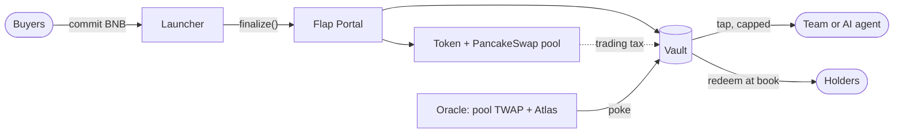

<div align="center">

<picture>
  <source media="(prefers-color-scheme: dark)" srcset="docs/assets/covenant-mark-dark.svg">
  
</picture>

<h1>Covenant</h1>

<p><b>The operating stack for autonomous ventures.</b><br>
Capital, budgets and exits for businesses run by AI agents. Enforced by code, not courts. 24/7 on BNB Chain.</p>

<p>
  <a href="https://covenant.adibuilds.in/docs/contracts"></a>
  <a href="contracts/foundry.toml"></a>
  <a href="web/package.json"></a>
  <a href="https://covenant.adibuilds.in/docs/agents"></a>
  <a href="SECURITY.md"></a>
  <a href="LICENSE"></a>
</p>

<p>
  <a href="https://covenant.adibuilds.in"><b>Website</b></a> ·
  <a href="https://covenant.adibuilds.in/app"><b>App</b></a> ·
  <a href="https://covenant.adibuilds.in/docs"><b>Docs</b></a> ·
  <a href="https://covenant.adibuilds.in/llms.txt"><b>llms.txt</b></a> ·
  <a href="JUDGES.md"><b>Judging? Start here</b></a>
</p>

</div>

> [!WARNING]
> Hackathon code on BNB testnet (chain 97) only. Not audited, nothing on mainnet. Do not use it with real funds.

## What it is

A team that raises money by launching a token asks buyers to trust it with the treasury. An AI agent running a business has even less to answer to. Covenant replaces that trust with code: a launcher and a vault for token raises on BNB Chain, built on [Flap](https://flap.sh)'s Pool Launch. Flap launches the token and its PancakeSwap pool, and most of the raise goes into a vault that runs five fixed rules. The same contracts bind a human team or an AI agent, and anyone can trigger the rules.

| Rule | What it does | Default |
|---|---|---|
| **Tap** | The team draws a dollar budget per 30 days, priced through Atlas BNB/USD and capped as a share of the treasury. It can only go down | $30,000, at most 4% |
| **Performance unlock** | Team tokens unlock only when the price holds at a multiple of the sale price, in dollars and in BNB | 2x, 4x, 8x after a 180-day cliff |
| **Book-value exit** | When the pool trades below treasury value per token for the exit streak, any holder can redeem at book | 3-day streak, 1% fee |
| **Abandonment switch** | If the team sends no heartbeat for the window, anyone opens the treasury to holders, fee-free, forever | 45 days |
| **Disclosure** | The team posts each period's report pointer and hash on chain | every period |



The [docs](https://covenant.adibuilds.in/docs) explain each step: [how it works](https://covenant.adibuilds.in/docs/how-it-works), [the five rules](https://covenant.adibuilds.in/docs/rules) and [concepts](https://covenant.adibuilds.in/docs/concepts).

<p align="center">
  
  <br>
  <sub>The app on BNB testnet: the first covenant ran every stage on chain 97, then its issuer stopped, the keeper declared it abandoned, and holders redeem at book with no fee.</sub>
</p>

## Try it

- **In the browser:** open [the app](https://covenant.adibuilds.in/app) on BNB testnet, connect a wallet and get test BNB from [BNB Chain's faucet](https://www.bnbchain.org/en/testnet-faucet). [Quickstart](https://covenant.adibuilds.in/docs/quickstart).
- **With an AI agent:** the MCP server reads BNB testnet with no key, and its write tools return unsigned, simulated transactions for your wallet to sign.
- **The whole stack on your machine:** a local chain, every contract, covenants at every stage, the API, the keeper, the agents and the web app.

```bash
git clone https://github.com/Adityaakr/Covenent.git && cd Covenent

# connect an agent (Node 22, pnpm)
pnpm --dir server install
claude mcp add covenant -- pnpm --dir "$PWD/server" mcp

# or run everything locally (also needs Foundry), then open http://localhost:8080
git submodule update --init
scripts/dev-all.sh
```

## Documentation

| | |
|---|---|
| [Docs site](https://covenant.adibuilds.in/docs) | Introduction, how it works, quickstart, the rules, concepts, founders and investors, architecture, security, known limitations, FAQ |
| [For agents](https://covenant.adibuilds.in/docs/agents) and [MCP reference](https://covenant.adibuilds.in/docs/mcp-reference) | Connecting Claude Code, Claude Desktop or Cursor; every tool, generated from the server |
| [`/llms.txt`](https://covenant.adibuilds.in/llms.txt), [`/llms-full.txt`](https://covenant.adibuilds.in/llms-full.txt) | The docs for language models; every page is also markdown at its URL plus `.md` |
| [Contracts and addresses](https://covenant.adibuilds.in/docs/contracts) | Every testnet address, from [`contracts/deployments/97.json`](contracts/deployments/97.json) |
| [JUDGES.md](JUDGES.md) | Every claim with the command that checks it |
| [docs/DESIGN.md](docs/DESIGN.md) | The deep design reference: rules, formulas, oracle design, threat model (written before the code; its banner lists where the code differs) |
| [docs/DEPLOY.md](docs/DEPLOY.md), [docs/KNOWN-ISSUES.md](docs/KNOWN-ISSUES.md), [SECURITY.md](SECURITY.md) | Deploy runbook and on-chain runs, every review finding, security policy |
| [server/README.md](server/README.md), [flap/README.md](flap/README.md), [AGENTS.md](AGENTS.md) | The server and its API, Covenant's flap.sh UI packages, the guide for coding agents |

The docs pages live in [`web/src/docs/content`](web/src/docs/content); the site, the `.md` twins and the llms files are all built from them.

## Status

- **On chain, current contracts:** `CVD`, launched by Flap's Portal through the demo factory pair (raise, finalize, token, pool, vault, sale-token claim, a strict poke on the Atlas push feed).
- **On chain, first deployment:** `CVT` ran every stage: raise, Flap launch, the issuer's budget and heartbeats, the issuer stops, the keeper declares abandonment, holders redeem at book.
- **On a fork only:** trading tax reaching a vault, ERC-8004 reputation writes, Four.meme Lite through OpenFour's ForwardVault.
- **Planned:** Cournot report checks.

## Repository

```
contracts/   Foundry, Solidity 0.8.26: launcher, vault, oracle, lens, Four.meme Lite vault; tests; deployments/
server/      TypeScript, Node 22: keeper, API, MCP server, issuer and investor agents, launch simulator
web/         Next.js 16: landing pages, docs (src/docs) and the app (/app)
flap/        Covenant's Launcher UI and Vault UI packages for flap.sh
scripts/     dev-all.sh (the whole local stack) and testnet helpers
docs/        design document, deploy runbook, known issues
```

Tests: `forge test` in `contracts/`, `pnpm test` in `server/` and in `web/`. [AGENTS.md](AGENTS.md) has every command.

## Built with

[Flap](https://flap.sh) Pool Launch · [PancakeSwap](https://pancakeswap.finance) · Atlas BNB/USD feeds · [ERC-8004](https://eips.ethereum.org/EIPS/eip-8004) agent identity · [Four.meme](https://four.meme) via OpenFour · [CoinMarketCap](https://coinmarketcap.com) DEX data · [BNB Chain](https://www.bnbchain.org)

## Security and license

Report vulnerabilities privately, as [SECURITY.md](SECURITY.md) describes. MIT, see [LICENSE](LICENSE); vendored third-party code keeps its own license ([NOTICE](NOTICE)).
